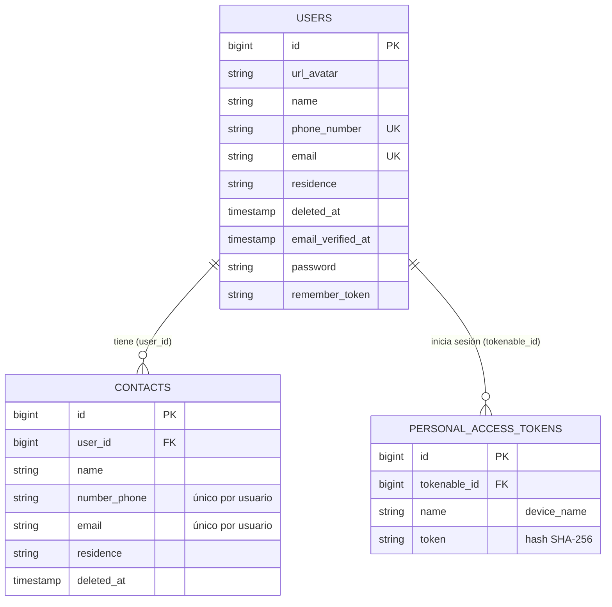

# Modelo de datos de Contact API

## Reglas

- Un usuario tiene muchos contactos; cada contacto pertenece a un solo usuario.
- `deleted_at` en ambas tablas: eliminar es un borrado lógico (soft delete).
- El correo y el teléfono de un usuario son únicos en toda la tabla `users`.
- El correo y el teléfono de un contacto no se pueden repetir dentro de la agenda
  del mismo usuario (se valida en la API; los contactos eliminados no cuentan).
- El nombre y la dirección (`residence`) sí se pueden repetir.
- Si un usuario se elimina definitivamente, sus contactos se eliminan en cascada.
